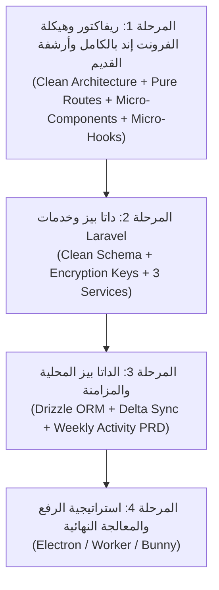

# خطة الريفاكتور الشاملة لمنصة Bamboo التعليمية (REFACTOR_PLAN.md)

## 📌 الرؤية المعمارية وأهداف المشروع
منصة تعليمية متكاملة عالية الأمان والأداء للبث والتحميل الأوفلاين للفيديوهات:
- **الموبايل (Frontend):** React Native Expo (SDK 53) بنمط المعمارية النظيفة (Clean Architecture) والتصميم الذري (Atomic Design) الدقيق بمكونات متناهية الصغر (Micro-Components)، شاشات Presentational خفيفة لا تتعدى 80 سطراً، وفصل الـ Logic بالكامل في Micro-Hooks و Pure Units، مع تطهير كامل لمسارات Expo Router.
- **الباك إند (Backend):** Laravel 12 + Filament v3 بنمط الخدمات المفصولة (Services & Actions) لحماية الفيديوهات وتقديم مفاتيح التشفير ومزامنة الدلتا الذكية.

---

## 🧭 الترتيب المعتمد للمراحل التنفيذية الأربع:



---

## 🎨 المرحلة 1: إعادة هيكلة وتطهير الفرونت إند بالكامل (Full Frontend Architectural Overhaul)
*(الفرع الحالي: `phase-1-react-native-ui`)*

### 1.1 المبادئ الصارمة للهيكلة (Grill-Me Architectural Standards)
1. **عزل وتطهير مسار Expo Router (`app/`):**
   - مجلد `app/` يحتوي **فقط** على ملفات التوجيه (Routes) والـ Layouts (`_layout.tsx`, `+not-found.tsx`, `(tabs)`, `(auth)`).
   - نقل كافة الشاشات والمكونات الموجودة حالياً بالخطأ داخل `app/screens/` و`app/components/` و`app/i18n/` إلى أماكنها الصحيحة خارج `app/`.
2. **الأرشفة الآمنة التامة دون حذف (Safe Archiving):**
   - إنشاء مجلد `frontend/legacy/` يحتوي على أقسام فرعية (`legacy/screens`, `legacy/components`, `legacy/hooks`, `legacy/services`).
   - نقل كافة الملفات الميتة أو السابقة أو الفولدرات المكررة (مثل `*.legacy.tsx`, `useVideoScreen.ts` القديم، الفولدرات الفارغة، الملفات ذات حجم 0-byte) إلى الأرشيف مع الحفاظ على كل سطر فيها.
3. **التصميم الذري المتناهي الصغر (Micro-Architecture):**
   - **Units / Utils:** دوال رياضية وحسابية نقية (Pure Functions) خالية تماماً من الـ React Dependencies والـ State.
   - **Atoms (< 50 سطراً):** عناصر أولية بصرية بحتة (Buttons, Badges, ThemedText, ProgressBar, Icons).
   - **Molecules (< 70 سطراً):** جزيئات مركبة أحادية المسؤولية (SearchInputs, FilterChips, StorageMeters, TeacherCards).
   - **Organisms (< 100 سطراً):** قطاعات هيكلية كاملة تجمع الجزيئات معاً.
   - **Screens (< 80 سطراً):** شاشات تجميعية رشيقة جداً تستدعي الـ Organisms وتتلقى البيانات من الـ Custom Hooks.
4. **التطابق السلوكي التام (100% Behavioral Parity):**
   - حظر كسر أي ميزة أو تفاعل أو routing parameter موجود حالياً في أي شاشة أثناء نقلها وتفتيتها.
   - التحقق المستمر عبر مترجم TypeScript (`npm --prefix frontend exec tsc -- --noEmit`).

---

### 1.2 الهيكل النموذجي المستهدف لمجلد `frontend/`
```text
frontend/
├── app/                      # Expo Router Routes ONLY (ملفات التوجيه والـ Layouts فقط)
│   ├── (auth)/
│   │   ├── login.tsx
│   │   └── _layout.tsx
│   ├── (tabs)/
│   │   ├── _layout.tsx
│   │   ├── index.tsx         # يستدعي <HomeScreen /> من screens/home
│   │   ├── explore.tsx       # يستدعي <ExploreScreen /> من screens/explore
│   │   └── library.tsx       # يستدعي <LibraryScreen /> من screens/library
│   ├── video/[id].tsx        # يستدعي <VideoDetailScreen /> من screens/video
│   ├── teacher/[id].tsx      # يستدعي <TeacherProfileScreen /> من screens/teacher
│   ├── all-teachers.tsx      # يستدعي <AllTeachersScreen /> من screens/teachers
│   ├── _layout.tsx
│   └── +not-found.tsx
│
├── screens/                  # الشاشات التجميعية الرشيقة (< 80 سطراً لكل شاشة)
│   ├── home/
│   ├── explore/
│   ├── library/
│   ├── video/
│   ├── teacher/
│   ├── teachers/
│   └── profile/
│
├── components/               # شجرة التصميم الذري الموحدة
│   ├── atoms/                # المكونات الذرية البسيطة
│   ├── molecules/            # الجزيئات المركبة
│   ├── organisms/            # الأقسام والهياكل المكتملة
│   └── ui/                   # المكونات الأساسية للثيم والأيقونات
│
├── hooks/                    # الـ Micro-Hooks أحادية المسؤولية
│   ├── useExploreScreen.ts
│   ├── useVideoDetailController.ts
│   ├── useLibraryVideos.ts
│   ├── useLibraryFilters.ts
│   └── ...
│
├── utils/ (أو units/)        # دوال نقية 100% للحسابات والفرز والتواريخ
│   ├── formatBytes.ts
│   ├── formatDuration.ts
│   ├── filterLibraryVideos.ts
│   └── date.ts
│
├── constants/                # الثوابت والألوان الموحدة
│   ├── Colors.ts
│   ├── Layout.ts
│   └── i18n/                 # نقل ملفات الترجمة خارج app/
│
├── types/                    # تعريفات TypeScript الصارمة الموحدة
│   ├── video.ts
│   ├── catalog.ts
│   ├── library.ts
│   └── auth.ts
│
├── services/                 # خدمات الـ API وقاعدة البيانات المحلية والتزامن
│   ├── api/
│   ├── db/
│   └── sync/
│
└── legacy/                   # أرشيف آمن لكافة الملفات والفولدرات القديمة وغير المستخدمة
    ├── legacy_screens/
    ├── legacy_components/
    ├── legacy_hooks/
    └── legacy_api/
```

---

### 1.3 خطة المهام التنفيذية المصغرة للمرحلة 1 (Bite-Sized Sub-Phases)

#### 🎯 الحزمة 1.A: الأرشفة الآمنة وتطهير مسار Expo Router (Housekeeping & Archiving)
- [ ] **المهمة 1.A.1:** إنشاء هيكل مجلد `frontend/legacy/` الفرعي بالكامل.
- [ ] **المهمة 1.A.2:** نقل الملفات الميتة الصريحة (`ExploreScreen.legacy.tsx`, `VideoDetailScreen.legacy.tsx`, `AuthService.ts` الفارغ، `useStorageState.ts` الفارغ، الفولدر الفارغ `frontend/screens`) إلى `legacy/`.
- [ ] **المهمة 1.A.3:** نقل `app/i18n` إلى `constants/i18n` وتحديث المسارات.
- [ ] **المهمة 1.A.4:** نقل المكونات العالقة في `app/components/` (`ActivationModal`, `ActiveDownloads`, `QRCodeScanner`) إلى مسار `components/` المناسب وتحديث مراجعها.
- [ ] **المهمة 1.A.5:** نقل الشاشات من `app/screens/` إلى `screens/` المركزية وتحديث مسارات استدعائها داخل routes مجلد `app/`.
- [ ] **المهمة 1.A.6:** فحص الـ TypeScript الشامل والتأكد من مرور `npm --prefix frontend exec tsc -- --noEmit` بنجاح بصفر أخطاء.

#### 🎯 الحزمة 1.B: توحيد الـ Types والـ Units النقية (Pure Units & Contracts)
- [ ] **المهمة 1.B.1:** إنشاء وتوحيد `types/library.ts` و`types/auth.ts` و`types/navigation.ts`.
- [ ] **المهمة 1.B.2:** إنشاء `utils/formatBytes.ts` و`utils/formatDuration.ts`.
- [ ] **المهمة 1.B.3:** إنشاء دالة `utils/filterLibraryVideos.ts` النقية.

#### 🎯 الحزمة 1.C: تفتيت شاشة المكتبة والتحميلات `LibraryScreen` (Micro-Components & Hooks)
- [ ] **المهمة 1.C.1:** بناء جزيئات المكتبة (`StorageMeter.tsx`, `FilterChipGroup.tsx`, `EmptyStateView.tsx`).
- [ ] **المهمة 1.C.2:** بناء Micro-Hooks المكتبة (`useLibraryVideos.ts`, `useLibraryFilters.ts`, `useLibraryActions.ts`).
- [ ] **المهمة 1.C.3:** بناء Organisms المكتبة (`LibraryStorageHeader.tsx`, `LibraryFilterSection.tsx`, `LibraryVideoList.tsx`).
- [ ] **المهمة 1.C.4:** إعادة بناء `screens/library/LibraryScreen.tsx` برمجياً في أقل من 80 سطراً مع الحفاظ على التفاعلات الـ 12 بنسبة 100%.

#### 🎯 الحزمة 1.D: تفتيت باقي المكونات القديمة الضخمة (God Components Cleanup)
- [ ] **المهمة 1.D.1:** تفتيت `ActivationModal.tsx` (22KB) إلى Micro-Dialog مع Hook مستقل `useActivationController.ts`.
- [ ] **المهمة 1.D.2:** تفتيت شاشة الملف الشخصي `screens/profile/ProfileScreen.tsx` و`EditProfileScreen.tsx`.
- [ ] **المهمة 1.D.3:** تنظيف وترتيب مجلد `hooks/` بنقل الخطافات القديمة غير المستخدمة إلى `legacy/hooks`.

#### 🎯 الحزمة 1.E: الفحص النهائي والاعتماد (Full Verification & Sign-off)
- [ ] **المهمة 1.E.1:** فحص TypeScript لكامل مشروع الفرونت إند بصفر أخطاء.
- [ ] **المهمة 1.E.2:** اختبار التوجيه في Expo للتأكد من عدم وجود Route Collisions أو تحذيرات.
- [ ] **المهمة 1.E.3:** اعتماد إغلاق المرحلة 1 بالكامل والتجهيز لـ Branch المرحلة 2.

---

## 🗄️ المرحلة 2: داتا بيز وخدمات Laravel المعمارية المتقدمة (Backend Clean Architecture & Video Security)
*(الفرع القادم: `phase-2-laravel-backend`)*

### 2.1 المبادئ الصارمة للباك إند (Grill-Me Backend Standards)
1. **Clean Code & SOLID / Thin Controllers:**
   - منع كتابة أي منطق أعمال (Business Logic) أو استعلامات داتابيز مباشرة أو عمليات تحقق يدوي داخل الـ Controllers.
   - تحويل كل طلب وارد إلى **FormRequest** مخصص يضمن الـ Validation والـ Authorization الصارم.
   - تفويض كل إجراء إلى **Action / Service Layer** أحادي المسؤولية (Single Responsibility).
   - توحيد مخرجات الـ API عبر **API Resources (JsonResource)** لمنع تسريب أسماء الحقول أو العلاقات الداخلية وحماية العقد البرمجي مع الموبايل.
2. **نمط الاستراتيجية لإدارة وتوزيع الفيديوهات (Video Provider Strategy Pattern):**
   - عزل مزودي الفيديوهات (YouTube vs Backblaze B2 vs HLS) عبر عقد موحد `VideoProviderInterface`.
   - اختيار المزود ديناميكياً عبر `VideoProviderFactory` دون تعديل الكنترولر.
   - دعم الفيديوهات المجانية (YouTube) والمدفوعة عالية الحماية (Backblaze B2 عبر التوكنات الموقعة، و HLS المشفر AES-128).
3. **أمان الرموز ومنع سباق العمليات (Race Condition & Atomic Locks):**
   - إحكام استهلاك وتفعيل أكواد الشحن عبر `Cache::lock('code:' . $code, 10)` لمنع استهلاك الكود مرتين بالتزامن من جهازين مختلفين.
   - التحقق الصارم من ربط الكود بالـ `device_id` وحساب عدد مرات المشاهدة والتحميل المتبقية بدقة ذرية.
4. **مبدأ Edge-Zero وكاشات الكتالوج فائقة الخفة (Zero-Load Snapshot Caching):**
   - تجهيز كاش كتالوج المراحل الدراسية `grade_{id}_catalog_snapshot` مسبقاً (Pre-warmed) وتحديثه عند تغيير البيانات فقط.
   - إصلاح خلل `If-Modified-Since` و `Last-Modified` لترجيع `304 Not Modified` فوري دون إرهاق MySQL باستعلامات الربط الثقيلة.
5. **استيعاب بيانات التيليميتري والتقييمات المجمعة دون ضغط السيرفر (Batch Telemetry & Low-Load Cron):**
   - استقبال تقارير المشاهدة (عدد الثواني ونسبة الإكمال) والتقييمات بالنجوم (1-5) في حمولة مجمعة (`POST /api/v1/telemetry/batch`).
   - ضخ البيانات فوراً في طابور Redis Buffer خفيف (`RPUSH telemetry_queue`) مع استجابة 200 OK في أقل من 15ms.
   - تفريغ الطابور وتحديث جداول MySQL وحساب متوسطات التقييمات في أوقات هدوء السيرفر (Low-Load Windows) لتفادي التأثير على الأنظمة الأخرى المشتركة على نفس السيرفر.

---

### 2.2 الهيكل النموذجي المستهدف لمجلد `backend/app/`
```text
backend/app/
├── Http/
│   ├── Controllers/Api/V1/
│   │   ├── AuthController.php              # تسجيل ودخول خفيف
│   │   ├── CatalogController.php           # كاش الكتالوج مع دعم 304 الصارم
│   │   ├── CodeValidationController.php    # كنترولر نحيف مفوض لـ CodeRedemptionService
│   │   ├── VideoController.php             # تسليم روابط التشغيل والتحميل عبر VideoDeliveryService
│   │   ├── TelemetryController.php         # استقبال دفعات التيليميتري والتقييمات في Redis
│   │   └── StudentInteractionController.php# تفاعلات الإعجاب والمتابعة
│   │
│   ├── Requests/Api/V1/
│   │   ├── ValidateCodeRequest.php
│   │   ├── RequestDownloadRequest.php
│   │   ├── BatchTelemetryRequest.php
│   │   └── InteractionRequest.php
│   │
│   └── Resources/Api/V1/
│       ├── CatalogResource.php
│       ├── VideoResource.php
│       ├── TeacherResource.php
│       ├── CodeValidationResource.php
│       └── PlaybackResource.php
│
├── Services/
│   ├── Video/                              # تطبيق نمط الاستراتيجية بالكامل
│   │   ├── Contracts/
│   │   │   └── VideoProviderInterface.php  # عقد المزود (Playback, Download, Keys)
│   │   ├── Providers/
│   │   │   ├── YouTubeVideoProvider.php    # استراتيجية اليوتيوب (Embed & yt-dlp)
│   │   │   ├── BackblazeB2VideoProvider.php# استراتيجية B2 (Signed JWT & Temp URLs)
│   │   │   └── HlsStreamVideoProvider.php  # استراتيجية HLS (AES-128 Encryption)
│   │   ├── DTOs/
│   │   │   ├── PlaybackPayload.php
│   │   │   └── DownloadOption.php
│   │   └── VideoProviderFactory.php        # مصنع اختيار المزود المناسب للطلب
│   │
│   ├── CodeRedemptionService.php           # منطق استهلاك الأكواد مع Atomic Lock
│   ├── VideoDeliveryService.php            # فحص الصلاحيات وطلب الروابط من المصنع
│   ├── PreWarmedCatalogService.php         # تجهيز وحفظ كاش المراحل الدراسية
│   └── TelemetryBatchService.php           # إدارة طابور التيليميتري في Redis
│
├── Console/Commands/
│   ├── PrewarmCatalogCacheCommand.php      # أمر artisan لتجهيز كاش الكتالوج مسبقاً
│   └── ProcessTelemetryQueueCommand.php    # معالجة تيليميتري والتقييمات في أوقات الهدوء
│
└── Models/
    ├── Video.php                           # علاقات مزود الفيديو والتقييمات
    ├── VideoRating.php                     # تقييمات الفيديوهات (1-5 نجوم)
    ├── TeacherRating.php                   # تقييمات المدرسين (1-5 نجوم)
    └── VideoEncryptionKey.php              # مفاتيح تشفير HLS (AES-128)
```

---

### 2.3 خطة المهام التنفيذية المصغرة للمرحلة 2 (Bite-Sized Sub-Phases)

#### 🎯 الحزمة 2.A: داتا بيز ونمذجة البيانات (Database Migrations & Models)
- [ ] **المهمة 2.A.1:** إنشاء Migration لجدول `video_ratings` (مع Unique Index مركب على `[student_id, video_id]`) ونموذج `VideoRating.php`.
- [ ] **المهمة 2.A.2:** إنشاء Migration لجدول `teacher_ratings` (مع Unique Index مركب على `[student_id, teacher_id]`) ونموذج `TeacherRating.php`.
- [ ] **المهمة 2.A.3:** إنشاء Migration لجدول `video_encryption_keys` (حفظ مفاتيح AES-128 و IV و Hash) ونموذج `VideoEncryptionKey.php`.
- [ ] **المهمة 2.A.4:** إنشاء Migration لتحديث جدول `videos` (إضافة `provider_type enum('youtube', 'backblaze_b2', 'hls')`، مسار `hls_path`، مفتاح `encryption_key_id`، حالة `status`، تاريخ النشر `published_at`).
- [ ] **المهمة 2.A.5:** إنشاء Migration لفهرسة حقول البحث والفرز في جدولي `codes` و `videos`.

#### 🎯 الحزمة 2.B: نمط استراتيجية مزودي الفيديوهات (Video Provider Strategy Pattern)
- [ ] **المهمة 2.B.1:** إنشاء العقد `App\Services\Video\Contracts\VideoProviderInterface` والـ DTOs (`PlaybackPayload`, `DownloadOption`).
- [ ] **المهمة 2.B.2:** بناء استراتيجية `YouTubeVideoProvider` للتعامل مع فيديوهات اليوتيوب المجانية وروابط التحميل المستخرجة.
- [ ] **المهمة 2.B.3:** بناء استراتيجية `BackblazeB2VideoProvider` للتعامل مع تخزين B2 وتوليد توكنات JWT الموقعة وروابط التحميل المؤقتة مع صلاحية زمنية محددة.
- [ ] **المهمة 2.B.4:** بناء استراتيجية `HlsStreamVideoProvider` لإعداد قوائم تشغيل m3u8 المحمية ونقاط تسليم مفاتيح التشفير.
- [ ] **المهمة 2.B.5:** بناء `VideoProviderFactory` لربط الموديل تلقائياً بالمزود المناسب مع آليات Fallback الذكية للبيانات القديمة.

#### 🎯 الحزمة 2.C: الخدمات الأساسية والأمان الذري (Core Backend Services & FormRequests)
- [ ] **المهمة 2.C.1:** بناء FormRequests الصارمة: `ValidateCodeRequest`, `RequestDownloadRequest`, `BatchTelemetryRequest`.
- [ ] **المهمة 2.C.2:** بناء `CodeRedemptionService` مع القفل الذري `Cache::lock` لمنع مشاكل الـ Race Condition وضمان استهلاك الكود بأمان.
- [ ] **المهمة 2.C.3:** بناء `VideoDeliveryService` لتسليم روابط المشاهدة والتحميل المفحوصة ومفاتيح التشفير للأجهزة المصرح لها فقط.
- [ ] **المهمة 2.C.4:** بناء `PreWarmedCatalogService` لمعالجة الكتالوج مسبقاً وتصحيح هيدرز HTTP 304 `Last-Modified`.
- [ ] **المهمة 2.C.5:** بناء `TelemetryBatchService` و أوامر المعالجة الهادئة في أوقات الهدوء (Low-Load Off-Peak Schedule).

#### 🎯 الحزمة 2.D: تنحيف الكنترولرز وبناء موارد الـ API (Thin Controllers & API Resources)
- [ ] **المهمة 2.D.1:** بناء API Resources موحدة (`CatalogResource`, `VideoResource`, `TeacherResource`, `CodeValidationResource`).
- [ ] **المهمة 2.D.2:** إعادة هيكلة `CodeValidationController` ليصبح نحيفاً للغاية (< 50 سطراً) مفوضاً لـ `CodeRedemptionService`.
- [ ] **المهمة 2.D.3:** إعادة هيكلة `CatalogController` للاعتماد على `PreWarmedCatalogService` وتطبيق كاش 304 بدقة.
- [ ] **المهمة 2.D.4:** إضافة نقاط النهاية الجديدة في `routes/api.php` (`/telemetry/batch`, `/video/playback`, `/video/download`, `/ratings`).

#### 🎯 الحزمة 2.E: الفحص والاختبار الشامل (Full Backend Verification)
- [ ] **المهمة 2.E.1:** تشغيل فحص الـ Syntax والـ Static Analysis لكافة ملفات الـ Backend.
- [ ] **المهمة 2.E.2:** اختبار استهلاك الأكواد المتزامن ومحاكاة Race Condition والتأكد من إحكام القفل الذري.
- [ ] **المهمة 2.E.3:** اختبار استجابة الكتالوج والتأكد من رجوع `304 Not Modified` بصفر استعلامات SQL.
- [ ] **المهمة 2.E.4:** اعتماد المرحلة 2 والدمج.

---

## ⚡ المرحلة 3: الداتا بيز المحلية بالموبايل والمزامنة (Drizzle ORM & Delta Sync)
*(الفرع القادم: `phase-3-local-db-sync`)*
- [ ] إعداد `Drizzle ORM` مع `expo-sqlite` بالـ Schema المطابقة لعقد الباك إند.
- [ ] دمج وثيقة النشاط الأسبوعي ومعدل الإنجاز (`PRD_WEEKLY_ACTIVITY_WIDGET.md`) في جداول SQLite.
- [ ] بناء محرك المزامنة الذكي (Pull/Push Delta Sync).
- [ ] تشفير المفاتيح في `expo-secure-store`.

---

## 🚀 المرحلة 4: استراتيجية الرفع والمعالجة النهائية (Electron / Worker / Bunny)
*(الفرع القادم: `phase-4-upload-strategy`)*
- [ ] حسم الخيار (تطبيق Electron للسناتر / Bunny.net / Worker VPS).
- [ ] ربط خط الإنتاج من الرفع والتشفير حتى التشغيل الأوفلاين.
