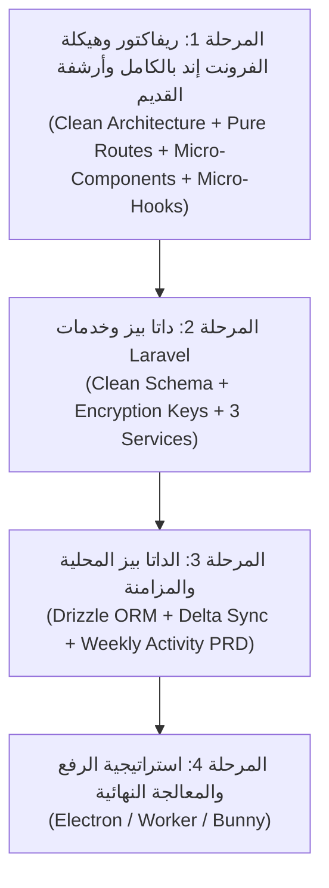

# خطة الريفاكتور الشاملة لمنصة Bamboo التعليمية (REFACTOR_PLAN.md)

## 📌 الرؤية المعمارية وأهداف المشروع
منصة تعليمية متكاملة عالية الأمان والأداء للبث والتحميل الأوفلاين للفيديوهات:
- **الموبايل (Frontend):** React Native Expo (SDK 53) بنمط المعمارية النظيفة (Clean Architecture) والتصميم الذري (Atomic Design) الدقيق بمكونات متناهية الصغر (Micro-Components)، شاشات Presentational خفيفة لا تتعدى 80 سطراً، وفصل الـ Logic بالكامل في Micro-Hooks و Pure Units، مع تطهير كامل لمسارات Expo Router.
- **الباك إند (Backend):** Laravel 12 + Filament v3 بنمط الخدمات المفصولة (Services & Actions) لحماية الفيديوهات وتقديم مفاتيح التشفير ومزامنة الدلتا الذكية.

---

## 🧭 الترتيب المعتمد للمراحل التنفيذية الأربع:



---

## 🎨 المرحلة 1: إعادة هيكلة وتطهير الفرونت إند بالكامل (Full Frontend Architectural Overhaul)
*(الفرع الحالي: `phase-1-react-native-ui`)*

### 1.1 المبادئ الصارمة للهيكلة (Grill-Me Architectural Standards)
1. **عزل وتطهير مسار Expo Router (`app/`):**
   - مجلد `app/` يحتوي **فقط** على ملفات التوجيه (Routes) والـ Layouts (`_layout.tsx`, `+not-found.tsx`, `(tabs)`, `(auth)`).
   - نقل كافة الشاشات والمكونات الموجودة حالياً بالخطأ داخل `app/screens/` و`app/components/` و`app/i18n/` إلى أماكنها الصحيحة خارج `app/`.
2. **الأرشفة الآمنة التامة دون حذف (Safe Archiving):**
   - إنشاء مجلد `frontend/legacy/` يحتوي على أقسام فرعية (`legacy/screens`, `legacy/components`, `legacy/hooks`, `legacy/services`).
   - نقل كافة الملفات الميتة أو السابقة أو الفولدرات المكررة (مثل `*.legacy.tsx`, `useVideoScreen.ts` القديم، الفولدرات الفارغة، الملفات ذات حجم 0-byte) إلى الأرشيف مع الحفاظ على كل سطر فيها.
3. **التصميم الذري المتناهي الصغر (Micro-Architecture):**
   - **Units / Utils:** دوال رياضية وحسابية نقية (Pure Functions) خالية تماماً من الـ React Dependencies والـ State.
   - **Atoms (< 50 سطراً):** عناصر أولية بصرية بحتة (Buttons, Badges, ThemedText, ProgressBar, Icons).
   - **Molecules (< 70 سطراً):** جزيئات مركبة أحادية المسؤولية (SearchInputs, FilterChips, StorageMeters, TeacherCards).
   - **Organisms (< 100 سطراً):** قطاعات هيكلية كاملة تجمع الجزيئات معاً.
   - **Screens (< 80 سطراً):** شاشات تجميعية رشيقة جداً تستدعي الـ Organisms وتتلقى البيانات من الـ Custom Hooks.
4. **التطابق السلوكي التام (100% Behavioral Parity):**
   - حظر كسر أي ميزة أو تفاعل أو routing parameter موجود حالياً في أي شاشة أثناء نقلها وتفتيتها.
   - التحقق المستمر عبر مترجم TypeScript (`npm --prefix frontend exec tsc -- --noEmit`).

---

### 1.2 الهيكل النموذجي المستهدف لمجلد `frontend/`
```text
frontend/
├── app/                      # Expo Router Routes ONLY (ملفات التوجيه والـ Layouts فقط)
│   ├── (auth)/
│   │   ├── login.tsx
│   │   └── _layout.tsx
│   ├── (tabs)/
│   │   ├── _layout.tsx
│   │   ├── index.tsx         # يستدعي <HomeScreen /> من screens/home
│   │   ├── explore.tsx       # يستدعي <ExploreScreen /> من screens/explore
│   │   └── library.tsx       # يستدعي <LibraryScreen /> من screens/library
│   ├── video/[id].tsx        # يستدعي <VideoDetailScreen /> من screens/video
│   ├── teacher/[id].tsx      # يستدعي <TeacherProfileScreen /> من screens/teacher
│   ├── all-teachers.tsx      # يستدعي <AllTeachersScreen /> من screens/teachers
│   ├── _layout.tsx
│   └── +not-found.tsx
│
├── screens/                  # الشاشات التجميعية الرشيقة (< 80 سطراً لكل شاشة)
│   ├── home/
│   ├── explore/
│   ├── library/
│   ├── video/
│   ├── teacher/
│   ├── teachers/
│   └── profile/
│
├── components/               # شجرة التصميم الذري الموحدة
│   ├── atoms/                # المكونات الذرية البسيطة
│   ├── molecules/            # الجزيئات المركبة
│   ├── organisms/            # الأقسام والهياكل المكتملة
│   └── ui/                   # المكونات الأساسية للثيم والأيقونات
│
├── hooks/                    # الـ Micro-Hooks أحادية المسؤولية
│   ├── useExploreScreen.ts
│   ├── useVideoDetailController.ts
│   ├── useLibraryVideos.ts
│   ├── useLibraryFilters.ts
│   └── ...
│
├── utils/ (أو units/)        # دوال نقية 100% للحسابات والفرز والتواريخ
│   ├── formatBytes.ts
│   ├── formatDuration.ts
│   ├── filterLibraryVideos.ts
│   └── date.ts
│
├── constants/                # الثوابت والألوان الموحدة
│   ├── Colors.ts
│   ├── Layout.ts
│   └── i18n/                 # نقل ملفات الترجمة خارج app/
│
├── types/                    # تعريفات TypeScript الصارمة الموحدة
│   ├── video.ts
│   ├── catalog.ts
│   ├── library.ts
│   └── auth.ts
│
├── services/                 # خدمات الـ API وقاعدة البيانات المحلية والتزامن
│   ├── api/
│   ├── db/
│   └── sync/
│
└── legacy/                   # أرشيف آمن لكافة الملفات والفولدرات القديمة وغير المستخدمة
    ├── legacy_screens/
    ├── legacy_components/
    ├── legacy_hooks/
    └── legacy_api/
```

---

### 1.3 خطة المهام التنفيذية المصغرة للمرحلة 1 (Bite-Sized Sub-Phases)

#### 🎯 الحزمة 1.A: الأرشفة الآمنة وتطهير مسار Expo Router (Housekeeping & Archiving)
- [ ] **المهمة 1.A.1:** إنشاء هيكل مجلد `frontend/legacy/` الفرعي بالكامل.
- [ ] **المهمة 1.A.2:** نقل الملفات الميتة الصريحة (`ExploreScreen.legacy.tsx`, `VideoDetailScreen.legacy.tsx`, `AuthService.ts` الفارغ، `useStorageState.ts` الفارغ، الفولدر الفارغ `frontend/screens`) إلى `legacy/`.
- [ ] **المهمة 1.A.3:** نقل `app/i18n` إلى `constants/i18n` وتحديث المسارات.
- [ ] **المهمة 1.A.4:** نقل المكونات العالقة في `app/components/` (`ActivationModal`, `ActiveDownloads`, `QRCodeScanner`) إلى مسار `components/` المناسب وتحديث مراجعها.
- [ ] **المهمة 1.A.5:** نقل الشاشات من `app/screens/` إلى `screens/` المركزية وتحديث مسارات استدعائها داخل routes مجلد `app/`.
- [ ] **المهمة 1.A.6:** فحص الـ TypeScript الشامل والتأكد من مرور `npm --prefix frontend exec tsc -- --noEmit` بنجاح بصفر أخطاء.

#### 🎯 الحزمة 1.B: توحيد الـ Types والـ Units النقية (Pure Units & Contracts)
- [ ] **المهمة 1.B.1:** إنشاء وتوحيد `types/library.ts` و`types/auth.ts` و`types/navigation.ts`.
- [ ] **المهمة 1.B.2:** إنشاء `utils/formatBytes.ts` و`utils/formatDuration.ts`.
- [ ] **المهمة 1.B.3:** إنشاء دالة `utils/filterLibraryVideos.ts` النقية.

#### 🎯 الحزمة 1.C: تفتيت شاشة المكتبة والتحميلات `LibraryScreen` (Micro-Components & Hooks)
- [ ] **المهمة 1.C.1:** بناء جزيئات المكتبة (`StorageMeter.tsx`, `FilterChipGroup.tsx`, `EmptyStateView.tsx`).
- [ ] **المهمة 1.C.2:** بناء Micro-Hooks المكتبة (`useLibraryVideos.ts`, `useLibraryFilters.ts`, `useLibraryActions.ts`).
- [ ] **المهمة 1.C.3:** بناء Organisms المكتبة (`LibraryStorageHeader.tsx`, `LibraryFilterSection.tsx`, `LibraryVideoList.tsx`).
- [ ] **المهمة 1.C.4:** إعادة بناء `screens/library/LibraryScreen.tsx` برمجياً في أقل من 80 سطراً مع الحفاظ على التفاعلات الـ 12 بنسبة 100%.

#### 🎯 الحزمة 1.D: تفتيت باقي المكونات القديمة الضخمة (God Components Cleanup)
- [ ] **المهمة 1.D.1:** تفتيت `ActivationModal.tsx` (22KB) إلى Micro-Dialog مع Hook مستقل `useActivationController.ts`.
- [ ] **المهمة 1.D.2:** تفتيت شاشة الملف الشخصي `screens/profile/ProfileScreen.tsx` و`EditProfileScreen.tsx`.
- [ ] **المهمة 1.D.3:** تنظيف وترتيب مجلد `hooks/` بنقل الخطافات القديمة غير المستخدمة إلى `legacy/hooks`.

#### 🎯 الحزمة 1.E: الفحص النهائي والاعتماد (Full Verification & Sign-off)
- [ ] **المهمة 1.E.1:** فحص TypeScript لكامل مشروع الفرونت إند بصفر أخطاء.
- [ ] **المهمة 1.E.2:** اختبار التوجيه في Expo للتأكد من عدم وجود Route Collisions أو تحذيرات.
- [ ] **المهمة 1.E.3:** اعتماد إغلاق المرحلة 1 بالكامل والتجهيز لـ Branch المرحلة 2.

---

## 🗄️ المرحلة 2: تعديلات داتا بيز وخدمات Laravel (Database & Core Services)
*(الفرع القادم: `phase-2-laravel-backend`)*
- [ ] إنشاء Migration لإضافة أعمدة الـ HLS وجدول `video_encryption_keys` وتصحيح `codes.expires_at`.
- [ ] بناء `CodeRedemptionService` مع Atomic Locking.
- [ ] بناء `VideoDeliveryService` لتسليم الـ Signed URLs والمفاتيح.
- [ ] بناء `VideoProcessingService` بنمط Strategy Pattern.

---

## ⚡ المرحلة 3: الداتا بيز المحلية بالموبايل والمزامنة (Drizzle ORM & Delta Sync)
*(الفرع القادم: `phase-3-local-db-sync`)*
- [ ] إعداد `Drizzle ORM` مع `expo-sqlite` بالـ Schema المطابقة لعقد الباك إند.
- [ ] دمج وثيقة النشاط الأسبوعي ومعدل الإنجاز (`PRD_WEEKLY_ACTIVITY_WIDGET.md`) في جداول SQLite.
- [ ] بناء محرك المزامنة الذكي (Pull/Push Delta Sync).
- [ ] تشفير المفاتيح في `expo-secure-store`.

---

## 🚀 المرحلة 4: استراتيجية الرفع والمعالجة النهائية (Electron / Worker / Bunny)
*(الفرع القادم: `phase-4-upload-strategy`)*
- [ ] حسم الخيار (تطبيق Electron للسناتر / Bunny.net / Worker VPS).
- [ ] ربط خط الإنتاج من الرفع والتشفير حتى التشغيل الأوفلاين.

---

## 💎 خطة التطوير البصري والـ UI/UX فائق الجودة (High Prime UI Architecture)
*(تدرج مستقبلي في مرحلة تلميع الواجهات والاستعراض النهائي)*
- [ ] **Liquid Glass & Glassmorphism (`expo-blur`):** إدراج خامات الزجاج السائل `BlurView` الشفافة في التاب بار وهيدرات التصفح والـ Modals مع تدرجات رقيقة ومحاذاة ديناميكية للألوان بحسب الثيم.
- [ ] **حركات ميكرو دقيقة (`react-native-reanimated` + `react-native-gesture-handler`):** إضافة تفاعلات لمس زنبركية (Spring Pressables)، وحركات دخول وانتقال سلسة للكروت والقوائم (Shared Element Transitions).
- [ ] **الترقية للهيدرات الناتيف الذكية (Native Stack Headers):** اعتماد الهيدرات الناتيف ذات العناوين الكبيرة المتقلصة (iOS Large Title collapse on scroll) للشاشات البسيطة (الإعدادات، الملف الشخصي، تفاصيل المحتوى) مع الحفاظ على Compound View Headers لشاشات الفلاتر والبحث لتفادي أخطاء الـ RTL في أندرويد.
- [ ] **إعادة هيكلة ملف الطالب والإعدادات (Portfolio & Advanced Settings Separation):**
  - **ملف الطالب (Student Portfolio):** إحصائيات المذاكرة والنشاط الأسبوعي، مؤشر الساعات المكتملة، شارات الإنجاز (Achievements & Streaks)، وبيانات الطالب التعليمية.
  - **مركز الإعدادات (Settings Center):** مظهر التطبيق (فاتح/داكن/تلقائي)، تفضيلات التخزين والأوفلاين (حد التخزين، مسح الكاش)، إعدادات مشغل الفيديو (السرعة الافتراضية، تخطي الإنترو)، وإدارة الأجهزة المسجلة لمنع مشاركة الحساب.
